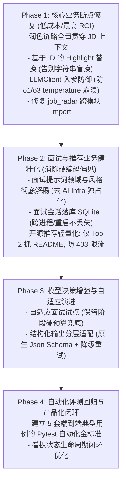

# JobHunt-Copilot 升级路线可行性审核与逆向评估报告 (Adverse Analysis)

> **审核对象**：`future-upgrade/README.md`（面向更强大模型的升级路线）  
> **审核日期**：2026-10-25  
> **报告性质**：架构可行性审核、工程落地风险研判与逆向技术对抗（Adverse Assessment）  
> **代码审计基准**：JobHunt-Copilot 当前主干源码（涉及 `core/`、`skills/`、`tools/`、`adapters/`、`tests/`）

---

## 1. 评估摘要与总体裁定 (Executive Summary)

### 1.1 总体结论
`future-upgrade/README.md` 是一份**专业水准极高、代码审阅极其细致**的重构规划。原案对当前系统 11 处核心工程断点的诊断**100% 属实**（且精准命中代码行级设计缺陷）。其提出的“将判断空间交给模型、将事实边界与确定性留在应用层”的核心哲学完全契合大模型工程演进趋势。

然而，从**“落地可行性（Feasibility）”**与**“投入产出比（ROI）”**视角进行逆向推演（Adverse Audit），原案在若干关键路径上存在**理想化假设**与**工程落地盲区**：
1. **GitHub API 速率硬限制盲区**：原案要求“检索并验证 README、目录和文件后再推荐”，在未配置 Token 时会瞬间击穿 GitHub 60次/小时的未认证配额，导致服务直接不可用。
2. **上下文检索过度设计**：原案建议对候选人材料建立类似“按需检索取证”机制；但应届生简历通常仅 2~4 个项目，总上下文不足 3k tokens，引入切片检索不仅存在漏召回风险，且属于典型的“屠龙刀杀鸡”。
3. **自适应面试的延迟雪崩风险**：若在每轮面试交互中引入多字段结构化决策，或调用高推理成本模型（如 o1/r1），单轮等待时间将飙升至 8~15 秒，彻底摧毁面试对话的真实感与节奏。
4. **P0 实施顺序的依赖倒置**：原案将“构建 30 个合成案例的基准评测体系”列为 P0 第一步；在单人或小团队开源项目中，过早陷入庞大的评测构建极易导致“分析瘫痪（Analysis Paralysis）”，延误立竿见影的核心业务 Bug 修复。

### 1.2 升级路径综合评估矩阵

| 升级路径 | 核心方向 | 代码诊断准确度 | 落地可行性 | 风险/代价等级 | 裁定意见 |
| :--- | :--- | :---: | :---: | :---: | :--- |
| **Path A** | Prompt 从操作配方转向任务契约 | ★★★★★ | **极高** | 🟢 低风险 | **完全采纳**：低成本、解耦明显，优先做。 |
| **Path B** | 上下文贯穿与事实证据库 | ★★★★★ | **中等** | 🟡 中风险 | **差异化采纳**：JD 上下文贯穿必做；细粒度事实图谱暂缓，防过度设计。 |
| **Path C** | 围绕证据自适应的模拟面试 | ★★★★★ | **中高** | 🔴 高延迟/失控风险 | **谨慎试点**：保留轮数预算底线，避免单轮多步推理引发延迟雪崩。 |
| **Path D** | 基于证据的修改提案 (ResumeEdit) | ★★★★★ | **极高** | 🟢 低风险 | **必须实施**：用稳定 ID 替代脆弱字符串替换是修复简历定制的核心。 |
| **Path E** | 客户端适配推理与原生结构化 | ★★★★★ | **极高** | 🟡 兼容性风险 | **必须实施**：修复 `temperature` 与 `max_tokens` 硬编码，保留 JSON 兜底。 |
| **Path F** | MCP 双轨演进与轻量化 | ★★★★☆ | **中等** | 🔴 体验劣化风险 | **务实微调**：坚决保留粗粒度复合工具，不可为了“解耦”逼宿主打十轮交互。 |
| **Path G** | 检索证据驱动的开源推荐 | ★★★★★ | **较低** | 🔴 速率配额熔断 | **大幅修正**：受限于 GitHub 60次/h 限流，仅对 Top-2 精选库抓 README。 |
| **Path H** | 本地记忆与可恢复练习闭环 | ★★★★☆ | **极高** | 🟢 低风险 | **完全采纳**：会话落库 `tracker.db`，天然契合项目架构。 |

---

## 2. 源码现状核实与原案诊断审计 (Reality Audit)

针对原案第 2 节列出的 11 处代码断点，本次审计对实际源码进行了逐行核对，审计结果证实**原案的诊断完全正确且非常敏锐**：

```mermaid
flowchart LR
    subgraph CurrentCode["当前代码中的真实断点"]
        M1["mock_interviewer: STAGE_ORDER 锁死 6 轮"]
        M2["mock_interviewer: 提示词绑死 AI Infra/CUDA"]
        M3["mock_interviewer: 切片截断 [:4] & 伪造默认高校"]
        W1["workflow: 润色未接收 JD 与技能缺口"]
        W2["workflow: 字符串盲查盲换 highlights"]
        J1["jd_matcher: 丢弃 raw_text 仅留扁平字段"]
        P1["project_recommender: 逼模型脑补文件路径"]
        L1["llm_client: 锁死 8192 & 硬塞 temperature=0.3"]
        A1["mcp_server: 内存字典存会话 & 宿主内套娃调用"]
        R1["job_radar: 直接跨模块 import jd_matcher (违规)"]
    end
    CurrentCode --> Verdict["核实结论：11 处问题全部真实存在，确系架构隐患"]
```

### 详细证据对照表
1. **面试状态机锁死** (`skills/mock_interviewer/state_machine.py` L23-30)：`MAX_TURNS_PER_STAGE` 严格写死 `INTRO: 1, RESUME_DEEP_DIVE: 2, FUNDAMENTALS: 1...`，无视候选人回答质量机械推进。
2. **领域绑死 AI Infra** (`skills/mock_interviewer/prompt.py` L19-33, L71-73)：`STRICT_ARCHITECT_SYSTEM` 指名道姓绑定 GPU/CUDA/Roofline/Triton；若面“前端”或“Java 后端”，考官仍然在问算子与访存合并。
3. **面试上下文硬截断与伪造事实** (`skills/mock_interviewer/handler.py` L37-48, L62-79)：
   - `_resolve_profile` 在加载异常时生成名为“求职者”、毕业于“目标高校”、“计算机科学与技术”的伪造档案，严重违反内容真实性原则；
   - `profile.projects[:4]`、`p.highlights[:2]` 强行截取，真正契合岗位的项目若排在第 5 项将彻底不可见。
4. **定制工作流的核心脱节** (`core/workflow.py` L260)：
   - `polish_report = polish_experiences(profile=tailored_profile, provider=provider)`，未传递 `parsed_jd`、`jd_text` 或 `match_result`；
   - `skills/resume_polisher/handler.py` 仅提取了原始经历清单和 `target_role` 字符串。所谓“针对目标岗位深度定制”在经历润色这一步完全是无 JD 上下文的通用改写。
5. **简历修改字符串盲换** (`core/workflow.py` L62-70)：
   - `polish_map = {item.original.strip(): item.polished.strip() for item in polish_report.items}`
   - `_replace_highlights` 依赖 `item.original` 原文字符串匹配。若同一项目内有多句相似表述，或模型返回的 `original` 存在标点差异，将直接导致替换失效或错位覆盖。
6. **开源推荐逼迫模型幻觉** (`skills/project_recommender/prompt.py` L22, `handler.py` L107-123)：
   - 模型仅收到仓库名称、Star、Topics 和 Description；
   - Prompt 却严厉要求：“`learning_path` 必须精确到具体文件或核心模块，如重点精读 `cache/manager.py` 与 `storage/`”——由于没有传入目录树，模型只能凭空虚构文件路径。
7. **LLM 客户端对新型推理模型不兼容** (`tools/llm_client.py` L133, L141)：
   - 始终传递 `payload["temperature"] = kwargs.get("temperature", self.config.temperature)`；若配置 OpenAI `o1`/`o3` 系列模型，API 会直接抛出 `400: Unsupported parameter: temperature`；
   - `min(max_tokens, 8192)` 强制截断，无法适配长上下文生成或新模型的 `max_completion_tokens`。
8. **违反 AGENTS.md 模块间解耦红线** (`skills/job_radar/handler.py` L13)：
   - 出现 `from skills.jd_matcher.handler import parse_jd, match_profile_with_jd`，直接跨模块耦合，违反“模块之间不得互相 import”的既定规则。

---

## 3. 升级路径的可行性审核与逆向风险评估 (Adverse Analysis)

### 3.1 路径 A：把 Prompt 从操作配方改成任务契约
*   **原案建议**：解耦风格与领域，将 Prompt 拆分为稳定边界、任务目标、任务上下文、可选策略。
*   **可行性结论**：**可行且低风险**。
*   **逆向风险与反思（Adverse Point）**：
    *   **弱模型的遵循度劣化**：任务契约式 Prompt 对强推理模型（GPT-4o, Claude 3.5 Sonnet, DeepSeek-V3）表现优异，但若用户使用本地部署的小参数量模型（如 Qwen2.5-7B, Llama-3-8B），缺少具体步骤指令（Step-by-step instructions）和少样本示例（Few-shot）会导致其生成内容结构松散、失焦甚至遗漏核心字段。
    *   **应对修正**：采用“分层模板引擎”。当检测到底层模型为轻量级/本地模型时，自动注入带引导约束的“结构强化垫片（Reinforcement Shim）”；对前沿云端模型则采用极简任务契约。

---

### 3.2 路径 B：上下文贯穿与事实证据库
*   **原案建议**：引入 `RoleContext`；设计 `CandidateFact` 与 `EvidenceReference` 实体；废弃固定截取，采用按需动态取证。
*   **可行性结论**：**部分可行，部分存在过度设计风险**。
*   **逆向风险与反思（Adverse Point）**：
    *   **过度工程化（Over-engineering Trap）**：
        应届毕业生的主档案规模极为有限：通常包含 1~2 段实习、2~4 个项目、1~2 个科研课题，全文 JSON 字符数通常在 3,000 ~ 6,000 字符以内（折合 1,500 ~ 3,000 tokens）。
        在这个规模下，设计一套包含 `source_id`, `verification_status`, `completion_status`, `scope` 的细粒度事实图谱和“按需检索系统（Dynamic Retrieval）”，不仅显著增加 `core/state.py` 的复杂度、破坏原有用户配置 `profile.yaml` 的直观可读性，而且相比**直接把完整 Profile 送入模型上下文**毫无优势。
    *   **切片召回的漏检代价高于全量上下文消耗**：
        现代 LLM 上下文窗口均在 32k~128k 以上，3k tokens 仅占窗口的 2%~5%，调用成本仅需几厘钱。若引入向量检索或关键词打分切片，一旦召回模块未命中关键的某一条科研成果，将直接导致匹配失效。
    *   **应对修正**：
        1. **必须做**：将 `parsed_jd` 与 `match_result` 作为上下文对象穿透到 `polish_experiences` 中。
        2. **暂缓做**：不要引入复杂的图谱或向量数据库。对学生档案实行“全量经历输入，由模型按 JD 相关性自主权重排序与遴选”。

---

### 3.3 路径 C：让模拟面试围绕证据自适应
*   **原案建议**：废除死板的固定轮数，由轻量决策对象（Decision Object）驱动下一步动作（追问、澄清、换题、收尾）。
*   **可行性结论**：**可行，但面临严重的对话延迟与失控风险**。
*   **逆向风险与反思（Adverse Point）**：
    *   **交互延迟雪崩（Latency Breakdown）**：
        在终端 CLI 或语音面试中，人类对对话停顿的忍耐极限通常在 2~3 秒内。
        若采用原案提议的单轮结构化决策（生成 `action`, `target_competency`, `evidence_ids`, `question`, `coverage_updates`），由于输出 JSON 需等待完整生成（或流式解析），且无法直接像纯文本那样打字机输出第一句话，候选人将面对持续 5~10 秒的静默等待。若使用带有思维链的推理模型（如 o1 或 DeepSeek-R1），静默时长可能长达 15~25 秒，面试互动体验将彻底断裂。
    *   **死循环追问与离题风险**：
        缺乏阶段锚点时，模型极容易陷入对某一个次要技术细节（例如某个日志框架的配置）进行 4~5 轮刨根问底，导致核心的基础能力、项目架构完全没时间考察。
    *   **应对修正**：
        1. **双流分步/隐式决策**：不要在每次发问时强制输出繁重的状态更新，只需输出简要的下一步动作类型和问题本身；
        2. **阶段软锚点机制**：保留 `STAGE_ORDER` 作为“软路标”（Progress Soft Targets），规定单阶段追问次数上限（例如最多连续追问 2 次），一旦超出强制触发状态机跃迁。

---

### 3.4 路径 D：基于证据的修改提案 (ResumeEdit)
*   **原案建议**：用稳定的经历/亮点 ID 替代原文字符串映射；生成修改提案，包含原版、修改版、证据与待确认项。
*   **可行性结论**：**极高可行性，性价比最高的核心重构**。
*   **逆向风险与反思（Adverse Point）**：
    *   **交互疲劳（CLI Approval Fatigue）**：
        如果为每条经历都生成一个 Diff 提案并要求候选人在终端打字确认（y/n），改写 15 条经历需要交互确认 15 次，会导致极度糟糕的 CLI 用户体验。
    *   **ATS 真实解析的外部依赖陷阱**：
        原案建议“对编译后的真实 PDF 提取文本以诊断 ATS 真实解析效果”。但本地 typst 编译出的 PDF 包含字体嵌入、矢量流等，引入 `pypdf` 或 `pdfplumber` 解析不仅会增加额外 Python 依赖，还会因中文 CID 字体映射问题产生偶发乱码，造成 ATS“伪假阴性”误报。
    *   **应对修正**：
        1. 在内存模型中为每个 `Highlight` 赋予只读 UUID 或稳定路径哈希（如 `proj_0_hl_1`）；
        2. 采用**默认批量合入 + 生成 Markdown 变更对比报告（Diff Report）**的模式，配合版本快照回滚机制，免除繁琐的手工交互确认。

---

### 3.5 路径 E：模型客户端现代化 (LLM Client)
*   **原案建议**：支持原生结构化输出（Structured Outputs）、工具调用、按模型特性适配参数（temperature、max_tokens 等）。
*   **可行性结论**：**极高可行性，属于底层防御性重构**。
*   **逆向风险与反思（Adverse Point）**：
    *   **供应商 API 碎片化灾难**：
        现实中各中继代理商（如各种 OpenAI 兼容网关、本地 vLLM、Ollama、OneAPI 等）对 `response_format: {"type": "json_schema"}` 的支持极不一致，常常直接报错 400 或 500。
    *   **应对修正**：
        不能将原生 Structured Outputs 作为唯一基石。必须采取**多层降级策略**：
        `Native json_schema` 失败时 $\rightarrow$ 降级为 `json_object` (JSON Mode) $\rightarrow$ 降级为 Prompt JSON + 正则抽取修复 + Pydantic 重试校验。
        同时对推理模型做入参过滤：自动检测模型名是否含 `o1`、`o3`、`r1`，若是则自动剥离 `temperature` 参数并转换 token 字段。

---

### 3.6 路径 F：MCP 服务的演进与工具拆分
*   **原案建议**：减少工具内部的重复 LLM 调用；拆分原子数据工具供宿主推理；面试会话持久化。
*   **可行性结论**：**中等可行性，存在破坏现有宿主协同体验的巨大风险**。
*   **逆向风险与反思（Adverse Point）**：
    *   **宿主端多轮交互的 Token 爆炸与授权灾难**：
        原案认为“宿主代理（如 Claude Desktop）已有强大推理能力，没必要让 MCP 内部再调用大模型”，提倡仅暴露原子工具（查档案、存会话、排版）。
        **这在理念上很优美，但在现实中会摧毁 MCP 体验**：
        如果宿主代理想要完成一次“一键岗位定向求职定制”，它必须先调用 MCP 读 Profile $\rightarrow$ 宿主自己思考 $\rightarrow$ 调用 MCP 检索 GitHub $\rightarrow$ 宿主自己思考 $\rightarrow$ 调用 MCP 校验修改 $\rightarrow$ 调用 MCP 编译 Typst。
        这会导致：
        1. **Token 消耗成倍增加**（每一次工具交互都要把全部历史 Context 来回传输给 Claude）；
        2. **用户必须在桌面端连续点击 5~10 次“允许工具执行”弹窗**；
        3. **受宿主上下文窗口截断影响，成品质量严重依赖宿主客户端的稳定性**。
    *   **应对修正**：
        **坚持复合门面工具（Composite Tools）为主，原子工具为辅**。
        `tool_tailor_application` 这种一键端到端物料交付工具必须作为主力工具保留；原子工具（如 `tool_query_profile`）仅作为只读辅助或专家调试使用。
        同时立即修复进程内字典 `_interview_sessions = {}`，将其统一持久化至本地 SQLite `storage/tracker.db`。

---

### 3.7 路径 G：检索证据驱动的开源项目推荐
*   **原案建议**：先检索并验证 README、目录和文件，再输出具体学习路径；允许“无合适推荐”。
*   **可行性结论**：**当前方案严重脱离外部 API 配额现实，可行性低，需大幅裁剪**。
*   **逆向风险与反思（Adverse Point）**：
    *   **GitHub API 速率限制的致命死穴（Rate Limit Pitfall）**：
        这是原案**最大的现实漏洞**。
        大多数个人用户不会在本地配置 `github.token`。在无 Token 情况下，GitHub API 限制为 **60 次请求 / 小时 / IP**。
        现存代码每次推荐搜索 1~3 个关键词，已经消耗 2~4 次请求；
        若按照原案要求：“对入选项目读取目录树并验证核心文件是否存在、检查 README”，假设候选有 5 个项目，读取每个项目的 Tree API + README API 将消耗：
        $$5 \times 2 = 10 \text{ 次额外请求}$$
        用户只要执行 3~4 次雷达扫描或岗位定制，**当小时内的 GitHub 配额就会被彻底榨干（抛出 HTTP 403 Forbidden）**，直接导致整个流水线中断报错！
    *   **网络 I/O 延迟与外网连接不稳定性**：
        国内用户直连 `api.github.com` 经常遭遇高延迟、连接重置或超时。多次深层 API 探针会显著拉长求职流水线的总耗时。
    *   **应对修正**：
        1. **绝对禁止全仓树（Full Tree）扫描**；
        2. **最小化证据检索**：仅对 LLM 初筛胜出的 **Top-2 确定推荐仓库**，通过一次请求获取其仓库默认分支的 `README.md` 摘要（截取前 2,000 字符），以此作为路径生成的依据；
        3. **本地预置/高频项目离线知识库**：对高频核心技术（如 Kafka, Redis, MIT6.824, CMU15-445, TinyWebServer 等）维护本地白名单元数据缓存，无网或限流时直接降级命中。

---

## 4. 实施阶段与测试基线的务实重构 (Roadmap Re-engineering)

### 4.1 原案 P0~P5 路线的致命缺陷：依赖倒置
原案规划的优先级为：
`P0: 建立 30 个合成案例与评测基线` $\rightarrow$ `P1: 修复信息链` $\rightarrow$ `P2: 自适应面试` $\rightarrow$ `P3: 结构化修改` $\rightarrow$ `P4: 客户端演进`

**逆向审查批判**：
1. **P0 的沉没成本过高**：在业务逻辑还存在重大明显断点（如润色未接收 JD、字符串替换 Bug）的情况下，花大量精力手工编造 30 个高质量合成档案、对应不同行业的 JDs 并编写复杂的评测打分器，不仅周期漫长，而且一旦后续数据契约发生微调，前期编写的评测用例大半需要重写。
2. **底层断点（P4）应该前置**：原案将 `llm_client.py` 的适配器放在 P4；但如果底层连 `o1`/`o3` 或不同模型参数都会报 400 崩溃，前面的 P1、P2 自适应面试将无法平稳接入新模型。

### 4.2 修正后的四阶段实战演进路线 (Re-prioritized Roadmap)

#### Phase 1：核心业务断点修复与防御性改造（立即实施，预计 1~2 天）
*   **P1.1 贯穿润色上下文**：修改 `core/workflow.py` 与 `skills/resume_polisher/handler.py`，将 `JobDescription` 与 `MatchResult` 传给 `polish_experiences`，实现真正的定向改写。
*   **P1.2 稳定 ID 替换**：在 `UserProfile` 经历亮点层面引入索引/ID 映射，废弃基于 `original.strip()` 的脆弱字符串替换，杜绝错改、漏改。
*   **P1.3 LLMClient 参数解耦**：移除统一写死的 `temperature=0.3` 和硬截断 `8192`，依据供应商与模型类型过滤入参，解决新模型报错。
*   **P1.4 修复架构违规**：将 `skills/job_radar/handler.py` 中对 `skills.jd_matcher` 的直接引用重构至 `core/workflow.py` 或由入参注入，严格遵守 `AGENTS.md`。

#### Phase 2：业务模块去偏见与健壮化（预计 2~3 天）
*   **P2.1 风格与领域解耦**：将 `mock_interviewer` 中的“严苛架构师/务实TL/亲和HR”人设与“AI Infra/CUDA/并行计算”解耦；由目标岗位 JD 动态注入领域考察重点（前端、后端、嵌入式、算法等）。
*   **P2.2 拔除虚假事实生成**：重构 `_resolve_profile`，当缺失配置时抛出明确配置异常或进入显式“匿名演示体验模式”，严禁在代码中写死“计算机科学与技术/核心开发”等虚假事实。
*   **P2.3 面试会话持久化**：将 `adapters/mcp_server.py` 的内存字典 `_interview_sessions` 迁移至本地 SQLite 或文件系统，支持服务重启后无缝恢复。
*   **P2.4 开源推荐防限流保护**：引入配额感知机制，仅对 Top-2 精选项目拉取 README，其余保持轻量元数据评估，提供优雅降级。

#### Phase 3：模型决策增强与自适应机制（预计 3~5 天）
*   **P3.1 受控自适应面试**：在状态机中增加模型追问决策，但必须设置每阶段硬轮数上限（如最多追问 2 次），保留 `/next`、`/finish` 快捷控制权。
*   **P3.2 结构化输出优雅降级**：实现 `Native json_schema` $\rightarrow$ `json_object` $\rightarrow$ 正则与 Pydantic 校验三级兜底。

#### Phase 4：轻量化金标准测试与回归体系（长期演进）
*   放弃繁琐的“30 个合成案例全量大模型人工评测”，改为由 **5 个典型基准用例（Golden Test Cases）构成的自动化 Pytest 套件**：
    1. 应届生通用 C++ 后端岗位定制用例
    2. 硕博跨专业 AI Infra 岗位面试自适应推进用例
    3. 前端/全栈岗位（校验领域提示词解耦）
    4. 缺少关键技能项的边界用例
    5. MCP 粗粒度工具并发与会话断线恢复用例
*   以确定性断言（是否包含 JD 关键词、是否改写了正确 ID、是否污染原配置、是否超时）为主，辅以低频的模型质检。

---

## 5. 核心结论与最终建议

`future-upgrade/README.md` 为 JobHunt-Copilot 指明了非常优秀的现代化演进方向，其所暴露的 11 项代码断点完全属实，极具工程改造价值。

但工程落地的核心在于**“在资源与环境约束下寻求最优解”**。本报告建议开发者：
1. **不要落入“全面 Agent 化”与“事实图谱化”的复杂性陷阱**：保持本地优先、轻量级、确定性排版的核心优势；
2. **优先解决上下文割裂与替换脆弱问题**（Phase 1 见效最快）；
3. **警惕外部环境约束（GitHub 限流、对话延迟雪崩、宿主 MCP 多轮通信成本）**；
4. 坚持**“模型负责建议与表达，代码负责边界、事实与状态持久化”**的铁律。
