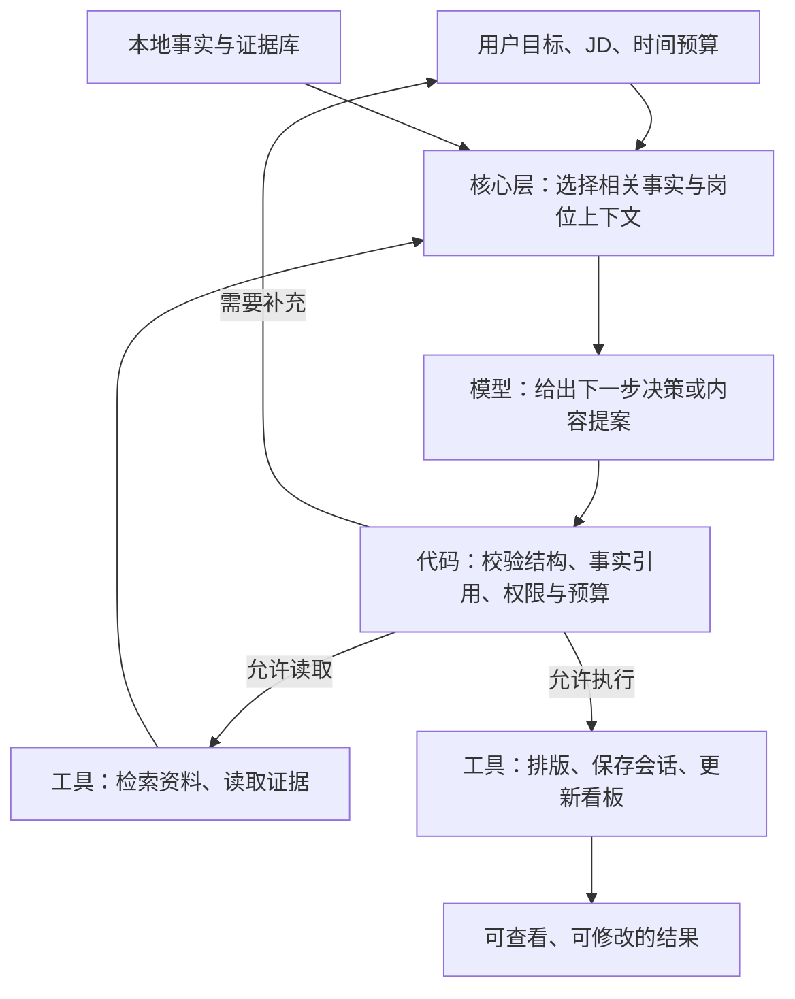

# JobHunt-Copilot：面向更强大模型的升级路线

> 本文件保留为初版分析。结合 [Adverse.md](Adverse.md) 复核后的开发顺序、范围与验收条件，请以 [最终开发路线 v1.0](FINAL-ROADMAP.md) 为准。

**当前阅读入口：[完整升级目录](UPGRADE-INDEX.md)。** M01～M09 的实现、使用命令、提交及测试进展以目录和各批开发记录为准；下文为最初讨论，不表示所有设想均已实现。

编写日期：2026-10-25  
性质：基于当前源码的架构评估与候选路线；本文没有实施业务改动，也不代表这些改动已经通过效果验证。

本文阅读范围包括核心数据契约与工作流、七个业务模块、模型客户端、MCP 适配层、仓库 Skill 和现有测试。没有读取真实个人配置、密钥或 `storage/` 私有产物，没有调用项目配置的大模型或 GitHub 服务。

用户提供的[视频链接](https://www.bilibili.com/video/BV1SQnB6CEpx/)未能通过本次网页检索取得可核实的正文或字幕。因此，本文不归纳视频原话，也不假定视频与下面的参考资料相同；判断来自本项目代码和文中链接的一手资料。

## 1. 对“固定设计会削弱模型能力”的判断

**这个判断有合理的方向，但需要通过具体任务验证。**

当程序提前决定了问什么、追问几次、只允许看到哪些经历、必须使用哪种表达结构时，即使换成更强的模型，它也只能在这些限制内作答。限制可能来自 prompt，也可能来自数据结构、上下文裁剪和调用链。仅删减 prompt，通常不能修复后面几种问题。

固定规则也有价值：一轮只问一个核心问题，有助于候选人作答；结构化输出有助于程序处理；个人事实边界、用户控制权和预算上限，更应继续由程序保障。**升级的重点是把判断空间交给模型，把事实、权限和执行可靠性留在应用层。**

OpenAI 关于重新审视 Skill 和提示词的文章指出，过度细化的操作配方可能妨碍更强模型，建议缩短描述并按需加载指导。这支持“定期重审旧约束”，但其讨论对象主要是编码代理，迁移到求职场景仍需本项目的实测。[官方文章](https://developers.openai.com/blog/rethinking-skills-and-prompts-for-gpt-6-astra)

OpenAI 的推理模型指南建议使用清楚、直接的任务目标，避免不必要的逐步推理指令，同时保留明确的成功标准。不同模型的提示方式并不完全相同，不能把“越短越好”当作新教条。[官方指南](https://developers.openai.com/api/docs/guides/reasoning-best-practices)

因此，下面所称的“潜在限制”是待验证的工程假设，不是已经测得的模型能力损失。

## 2. 当前代码中最值得优先处理的断点

| 代码位置 | 当前行为与潜在影响 | 升级方向 |
| --- | --- | --- |
| [面试状态机](../skills/mock_interviewer/state_machine.py) | `STAGE_ORDER` 固定；项目深挖固定 2 问，其余主要阶段各 1 问。重要疑点未解决时，程序也会推进。 | 依据证据覆盖与回答内容决定追问；代码保留时长、轮数上限和退出控制。 |
| [面试提示词](../skills/mock_interviewer/prompt.py) | 技术面试官与评估角色明显偏 AI Infra/HPC；“严苛风格”和“领域知识”绑定。通用产品可能问错方向。 | 将岗位领域、面试官风格、难度和训练目标分开配置。 |
| [面试上下文](../skills/mock_interviewer/handler.py) | 项目取前 4 项、科研取前 3 项、实习取前 2 项，亮点也截取前几条；相关证据可能排在后面。 | 按 JD 和当前问题选择证据，支持按需读取原文。 |
| [面试档案处理](../skills/mock_interviewer/handler.py) | `_resolve_profile` 在加载失败时返回带默认学历等字段的画像；摘要对缺失项目角色填“核心开发”。这可能让示例或缺失信息看起来像事实。 | 区分匿名练习、档案缺失和配置错误；未知角色保持未知。 |
| [定制工作流](../core/workflow.py)与[经历润色](../skills/resume_polisher/handler.py) | 先生成 JD 分析和调优建议，润色时却主要只传经历清单与目标岗位名，未收到完整 JD、需求证据及匹配结果。 | 把岗位上下文、选材计划和证据一起传入；实现真正的定向改写。 |
| [经历替换](../core/workflow.py) | `_apply_polish_to_profile` 用原始字符串映射润色结果。重复文本可能冲突，原文稍有差异又可能无法替换。 | 用稳定的经历/亮点 ID 和带版本的修改提案。 |
| [JD 匹配](../skills/jd_matcher/handler.py)与[数据契约](../core/state.py) | 匹配阶段使用结构化要求，未继续传 JD 原文；缺少“原文未提及”“候选人未提供证据”等细分状态。 | 保留原文引用与不确定性，避免把未知直接判为缺失。 |
| [开源推荐](../skills/project_recommender/handler.py)与[提示词](../skills/project_recommender/prompt.py) | 模型主要收到仓库元数据，却被要求给出精确学习文件路径；星数与候选数量也在代码中预先筛选。 | 先检索并验证 README、目录和相关文件，再给具体路线；允许无合适推荐。 |
| [模型客户端](../tools/llm_client.py) | 统一走 Chat Completions 文本接口，始终传 temperature；输出上限统一裁到 8192，结构化输出主要依赖 JSON mode、修复和 Pydantic。 | 按模型实际能力适配参数、工具调用、结构化输出和任务预算。 |
| [MCP 服务](../adapters/mcp_server.py) | 许多工具本身再次调用项目内的 LLM；面试会话放在进程内字典。宿主代理难以直接复用当前对话判断，重启也丢会话。 | 增加可组合的数据/执行工具和持久会话，保留原有便捷工具。 |
| [现有测试](../tests/) | 主要覆盖 MCP 协议、工具发现、看板与本地生成，没有衡量追问质量、定向程度和事实忠实度的业务评测。 | 建立固定案例、人工标准和模型升级回归评测。 |

这些观察不意味着上述设计在所有情况下都不好。例如固定六轮可以作为“快速体验模式”，但不宜成为所有面试的唯一策略。

## 3. 应继续保留什么

| 类型 | 建议 |
| --- | --- |
| 主档案与定制稿分离 | 保留深拷贝与本地输出；生成内容不自动变成候选人的真实经历。 |
| 内容真实性 | 保留实际贡献、熟练度、完成状态和指标来源；缺少数据时允许追问、占位或如实省略。 |
| 数据契约 | 继续使用 Pydantic；让契约表达证据与不确定性，减少只为展示而设的限制。 |
| 确定性工具 | PDF/Word 排版、数据库事务、路径检查、状态提交由代码负责。 |
| 会话控制 | 用户的跳过、暂停、结束指令优先；故障不能导致无限循环或重复写入。 |
| 模块边界 | 跨业务协调放进 `core/`，数据经 `core/state.py` 流转，技术客户端留在 `tools/`。 |
| MCP 传输 | stdout 只承载协议；运行日志走 stderr，并避免输出档案、完整请求或密钥。 |

例如，岗位雷达当前直接导入 JD 匹配模块；未来重构时应把这段跨模块协调移入核心编排层，遵守仓库现有约束。

## 4. 目标架构：稳定工具、按需上下文、有限度的模型决策

建议在现有分层上演进，不必首先引入大型代理框架。



模型负责选择下一道问题、判断信息缺口、拟定简历改写；代码负责允许什么动作、数据是否有效以及如何安全保存。不是每个请求都需要循环：导出基础简历可以直接调用排版工具，批量 JD 解析也可以继续采用可预测的流水线。

Anthropic 的架构文章区分预定义工作流与模型动态决策，并建议从满足需求的简单方案开始，按实际收益增加复杂度。这里采用其架构原则，不照搬其中已有年代差异的模型或工具细节。[原文](https://www.anthropic.com/research/building-effective-agents)

## 5. 升级路径 A：把 prompt 从操作配方改成任务契约

### 改什么

将提示内容拆成四部分，按任务组合：

1. **稳定边界**：事实来源、未知信息处理、隐私和用户控制权。
2. **任务目标**：这次要判断或产出什么，以及怎样算完成。
3. **任务上下文**：JD、相关经历、当前回答、已经验证和未验证的内容。
4. **可选策略与风格**：语气、难度、报告详略、可参考的提问方法。

把“你是严苛面试官”与“你熟悉 GPU/CUDA”分开。前者是风格，后者由目标岗位决定。将“绝不上台讲课”限定在模拟考核模式；训练模式应允许用户请求提示、讲解、重答。

不必删除所有示例。先测试无示例版本；只有发现稳定失败模式时，补充少量有针对性的例子，避免例子把所有岗位带向后端或某一种项目。

### 一个候选任务契约

下面是待评测的设计示例，不是已经验证的最终 prompt：

```text
你正在帮助候选人练习目标岗位面试。
根据岗位要求、候选人提供的事实和已完成问答，选择下一道最有价值的问题。

目标是收集足够的回答证据，识别具体的掌握程度与改进点。
先处理重要且尚未澄清的疑点，再补充未覆盖的关键能力。
问题领域由岗位决定，语气由所选风格决定；每次提出一个核心问题。

档案缺失不代表候选人没有能力。允许候选人说明未做过、未测量或需要补充。
不得替候选人补造经历，也不得假扮掌握目标公司的内部情况。
遵守用户的训练模式、跳过/结束指令和剩余预算。

返回下一步动作、面向候选人的问题、引用的证据 ID，以及简短决策依据。
```

“简短决策依据”用于调试和解释，例如“需要澄清个人贡献”，不要求记录模型内部逐步思维。接口结构可保持稳定，具体提问方式可以改变。

### 如何验证

在同一模型、相同上下文和预算下，对比现有 prompt 与任务契约，观察岗位相关性、事实错误、重复追问、延迟和用户偏好；不能仅凭新版听起来更自然就认定成功。

## 6. 升级路径 B：优先修复上下文与事实表达

这通常比扩大模型或增加代理数量更值得先做。

### 6.1 岗位上下文贯穿完整流程

新增 `RoleContext` 一类核心数据对象，逐步纳入：

- JD 原文及来源时间；
- 结构化要求，以及对应原文片段；
- 要求类别：硬性条件、偏好、加分项、尚不明确；
- 与候选人经历的证据关联；
- 投递目标和用户明确的写作偏好。

定制润色必须收到这个对象，不能只知道“后端工程师”这样的岗位名。面试也应支持实际 JD，避免仅凭公司名与岗位名想象招聘标准。

### 6.2 事实有来源，判断有状态

可在 `core/state.py` 中逐步增加 `CandidateFact`、`EvidenceReference`，至少表达：

| 字段 | 用途 |
| --- | --- |
| `id` | 稳定引用，避免用原文字符串充当主键 |
| `statement` | 事实或候选人自述 |
| `source_id / source_span` | 来自档案哪一项、会话哪一轮或哪个文件 |
| `verification_status` | 用户自述、材料支持、待确认、存在冲突 |
| `completion_status` | 计划、学习、进行中、已完成 |
| `scope` | 个人贡献、团队成果或范围不明 |

候选人当前会话的新说明也可以成为来源，并保留“用户自述”标签；不要把旧档案当成不可更新的唯一真相。出现冲突时定位冲突并澄清，不静默覆盖。

“未提到 Kubernetes”应首先标为“尚无证据”，而不是直接等同“不会 Kubernetes”。学历、毕业时间等可做明确条件核验；复杂能力判断允许保留未知。

### 6.3 按相关性取证，不固定取前 N 项

先用轻量检索或明确规则选择与岗位相关的材料，再按当前问题补取原文。规模很小时，关键词与结构化过滤就足够，无需先建向量数据库。

保留来源 ID、关键限定词和必要原文，避免多层摘要把“参与”“学习过”“尚未测量”裁掉。长对话摘要必须可追溯到原始问答，不能把模型推断写成用户事实。

对外发送采用字段白名单。岗位分析一般不需要姓名、手机号、邮箱、照片等字段；所谓“脱敏摘要”也不应默认包含全部剩余档案。

## 7. 升级路径 C：让模拟面试围绕证据自适应

这是最适合展示升级价值的一条路线。

### 7.1 从轮数推进改成覆盖与预算共同决定

保留阶段作为导航，但允许模型提出：

- 追问当前问题；
- 澄清候选人的职责或指标口径；
- 换一个问题验证同一能力；
- 转向尚未覆盖的能力；
- 回答候选人的反问；
- 在证据足够或预算用尽时收尾。

代码保留总时长、总轮数、工具次数和连续追问上限，并检测重复问题。自适应失败或模型不支持结构化决策时，可以退回现有固定流程。

可以提供三种体验：快速体验、限时模拟、单项训练。用户只想练一个项目时，不必强制走完全部阶段。

### 7.2 用一个小型决策对象驱动下一轮

以下为合成示例，不涉及真实候选人：

```json
{
  "action": "clarify",
  "target_competency": "性能测量与结果解释",
  "evidence_ids": ["turn_03"],
  "question": "你刚才提到耗时下降，这个结论使用了什么基线和测试输入？",
  "decision_summary": "已有性能结论，但测量口径尚未说明",
  "coverage_updates": [
    {
      "competency": "性能测量与结果解释",
      "status": "needs_evidence"
    }
  ]
}
```

动作枚举限定可执行范围，不规定模型必须使用哪套思考步骤。程序校验证据 ID、动作是否合法、问题是否为空，再提交会话变更。

不必每轮串联“分析模型—出题模型—评审模型”三次请求。可以先用一次调用同时产生决策与问题，深度评估放在结束后；是否拆分由延迟和质量评测决定。

### 7.3 评价引用回答，允许“未观察到”

复盘按 JD 建立能力项；每项给出支持它的问答引用和具体缺口。没有被考察到的能力标“未观察到”，不默认给低分。

不要从一次简短文字回答推断候选人的真实抗压性或职场人格。不要把模型的“建议通过”展示成真实雇主的录用判断。

参考回答分开表达：

- 原理或方法上的示范；
- 候选人可以据实填写的个人经历框架。

示范不能把候选人未完成的工作、未测量的性能写成已经取得的成果。

### 7.4 示例：升级后的交互

候选人说：“我只复现了教程里的算子，还没有系统测试。”

系统应接受这个边界，转向“你如何检查正确性”“下一步会如何设计测试”等有价值问题。已经解释清楚的部分可以结束，关键疑点则可继续追问，而不是机械达到两轮后跳走。

验收重点是追问是否使用了刚才回答里的具体信息，以及它是否帮助识别能力；不是追问数量越多越好。

## 8. 升级路径 D：从整段润色走向有证据的简历修改提案

### 8.1 先选材，再改写，再验证

建议将定制流程改为：

1. 明确岗位要求与候选人事实。
2. 选择最相关经历，给出篇幅和顺序建议。
3. 对稳定 ID 指向的亮点生成修改提案。
4. 校验事实与来源，展示前后差异。
5. 将用户接受的提案用于定制稿。
6. 用现有确定性排版工具导出，再检查成品。

“用户接受”可以是一次批量接受，也可以沿用用户事先设置的自动接受策略；不要求每一行都反复确认。

建议的 `ResumeEdit` 至少包含目标 ID、原文版本、建议文本、关联 JD 要求、证据 ID 和待确认项。代码负责防止引用不存在的经历、覆盖过期版本或错改同名文本。

### 8.2 校验能做什么，不能做什么

数字、日期、技术名和完成状态可以先做确定性比对；涉及语义扩大的修改再做模型审查或人工复核。引用了真实证据 ID 不代表新句子必然正确，还要判断该证据是否支持这句话。

让模型能够返回“原文已清楚，不建议修改”，也能建议暂不导出含重大待确认项的版本。避免为每个 bullet 强行补齐完整 STAR，或为关键词覆盖牺牲可读性。

### 8.3 诚实展示“匹配度”和“ATS 诊断”

当前 ATS 工具主要评估档案摘要，不能据此证明导出的 PDF 可正确解析，更不能证明某个招聘平台会如何筛选。

升级后分别展示：

- 真实导出文件的文本提取、阅读顺序与字段完整性；
- JD 关键词和要求的证据覆盖；
- 经历表达与岗位相关性；
- 仍未知、需补充或无法判断的条件。

匹配分数用于辅助比较，不展示成录用概率。不同评分版本需要标识，避免把一次 prompt 更新造成的分数上涨误当成能力提升。

另外，物料生成完成不等于已经投递。当前核心流程默认可以登记为 `APPLIED`，MCP 默认则不自动登记；未来应区分“已准备物料”和“用户确认已提交”，统一语义，避免看板失真。

## 9. 升级路径 E：让模型能力进入系统，而不只更换模型名

Chat Completions 仍可作为兼容路径。问题在于把所有模型视作同一种文本接口，而不是这个接口名称本身。

### 9.1 建立能力描述与适配器

在配置示例与客户端层增加可扩展的能力描述，例如：

- 支持的 API/认证方式；
- 文本、图片、音频等输入输出能力；
- 原生结构化输出与支持的 schema 子集；
- 工具调用与工具结果继续对话；
- 可设置的推理预算、输出预算和采样参数；
- 流式事件、使用量和请求终止原因。

根据具体提供商、模型和端点验证能力，不能仅凭供应商名称猜测。未知能力采用保守默认与可选探测，探测结果要有时间和版本。

不是所有模型都接受相同的 temperature 或 token 参数；当前统一的 8192 上限也应改成任务预算与模型上限共同约束。不要直接删除预算控制。

### 9.2 结构化输出交给协议，语义正确性继续校验

支持时使用原生 schema 约束；不支持时保留 JSON mode、Pydantic 校验和有限重试。JSON mode 主要保证 JSON 格式，原生 Structured Outputs 进一步约束 schema，但二者都不能保证内容真实。[官方说明](https://developers.openai.com/api/docs/guides/structured-outputs)

区分完整成功、截断、拒绝、网络失败和 schema 校验失败。不要把被截断后“修复成功”的 JSON 无声当成完整报告；修复状态应保留，关键写操作不能直接依据不完整结果执行。

### 9.3 质量、等待时间和成本一起管理

按任务选择模型与预算：简单字段提取、交互追问、复杂选材不必使用同一配置。记录首个可见输出时间、总耗时、工具次数、已知 token 用量和失败原因。

日志默认只记录必要元数据；本地调试若需正文，也应经过明确的数据策略并允许清除，不记录隐藏推理内容。模型或供应商切换时，重新检查用户的数据外发范围，不能静默扩大。

未来模型升级优先通过能力配置、适配器和回归评测接入，不把某个当前型号写成架构前提。

## 10. 升级路径 F：利用已有 MCP，减少重复的智能层

目前项目已经有 MCP，这是很好的演进起点。可以选择两条兼容路线：

| 路线 | 工作方式 | 适用场景与代价 |
| --- | --- | --- |
| 宿主负责推理 | Codex 等宿主利用当前对话决策，项目提供事实查询、会话保存、修改校验、简历渲染和看板操作。 | 对现有 AI 工具用户改造较小；受宿主模型、上下文与权限约束，体验需分别验证。 |
| 项目内置决策循环 | CLI 或未来 UI 调用项目自己的模型适配器，核心层管理上下文、决策和执行。 | 使用者不依赖特定宿主；项目需要维护模型调用、恢复、预算和评测。 |

推荐先把工具边界做清楚，再决定哪条路线承担主体验。宿主已有足够推理能力时，没必要让每个“思考型 MCP 工具”再调用另一个模型才能完成任务。

可逐步增加以下工具能力，名称仅为草案：

- 按范围查询候选人证据；
- 创建、读取和追加面试会话事件；
- 校验简历修改提案；
- 使用被接受的定制快照渲染简历；
- 读取岗位上下文和报告；
- 根据用户意图提交看板变更。

工具应该返回类型清楚的结果与可恢复错误。旧的“一键定制”“开始面试”等组合工具继续保留，避免一次升级破坏已有客户端。

传入宿主的资料仍要按任务最小化。MCP 不是隐私隔离层，删除手机号和邮箱也不意味着其余档案可以任意外发。

## 11. 升级路径 G：让推荐建立在检索证据上

当前开源推荐最需要补齐的是“取得足够证据”，而不是再写一份更有说服力的推荐 prompt。

建议的检索顺序：

1. 根据技能缺口、可投入时间、设备和已有语言经验选择搜索条件。
2. 获取仓库元数据与 README，初步判断是否适合练习。
3. 只对入选项目读取目录和相关文档；引用具体文件前验证它存在。
4. 返回与缺口的关系、可完成的小任务、验证方法和资料引用。
5. 条件不合适时允许无推荐，或建议自己实现一个更小的练习。

星数是辅助信号，不应代替适配性。维护情况、许可证、依赖、运行设备与学习成本也应纳入判断。精确文件链接最好绑定已查看的提交版本，并保留检索时间，避免目录变化后仍给过期路径。

把“读源码”“跑通示例”“自己实现”“性能测试”“参与贡献”分成不同完成状态。只有用户提供相应成果证据后，才可生成对应程度的简历描述。

JD、网页和仓库正文都属于外部数据，其中出现的指令不能改变应用权限或事实规则。资料读取不顺带执行仓库安装脚本，也不授予任意本地文件访问；这条执行边界由工具层保障。

岗位雷达同样可以先增加 JD 去重、来源时间和原文引用，再考虑网站采集。招聘网站采集、RSS、定时任务和邮件通知属于另一条产品路线，当前配置中的字段不能视为已实现能力。

## 12. 升级路径 H：增加可恢复的练习闭环和更自然的交互

### 本地记忆

优先持久化面试会话、原始回答、已覆盖能力、待澄清项和用户接受的修改。长期能力记录应附带日期、来源和状态，允许用户查看、纠正、删除。

不要把一次模型评价固化成“用户不会某项技术”。摘要丢失或模型升级时，应能从原始事件重建。

会话应支持暂停、恢复和断线重试；写操作带请求 ID 或版本，避免重试导致重复投递记录、重复回答或重复导出。涉及模型的写入先验证结果，再原子提交状态。

### 交互体验

先做好一个顺畅的文字流程，再考虑本地界面或语音：

- 开始时只收集缺失且必要的信息：目标 JD/岗位、模拟还是训练、时间预算。
- 允许自然表达“这个项目继续问”“给我一点提示”“这题重答”，保留快捷指令兼容。
- 过程显示当前目标、等待状态和剩余预算；不向候选人倾倒内部调试字段。
- 报告定位到具体问答，并把短板转成下一次可练的小任务。
- 语音阶段允许用户检查转写；技术名词识别错误不能直接成为能力扣分依据。

本地持久化数据继续放在被忽略的私有存储中。离线模式应真正阻止外部请求；若只支持本地模型和有限工具，就清楚展示可用功能。

## 13. 怎样证明升级有效

现有测试应继续用于协议和确定性逻辑，同时增加业务评测。评测的重点是本项目真实任务、持续回归和人工校准，而不是只看一次模型打分。[OpenAI 评测原则](https://developers.openai.com/api/docs/guides/evaluation-best-practices)

这里建议自有、可迁移的案例与评分脚本，不依赖某个特定厂商托管评测产品的生命周期。

### 13.1 从小型合成案例集开始

建议首批 30 个案例，均使用合成档案和 JD：

| 类型 | 数量 | 必须覆盖的情况 |
| --- | ---: | --- |
| 面试 | 10 | 不同岗位、回答已充分/空泛、诚实承认不会、未测量、用户跳过、反问、重复追问 |
| 简历 | 8 | 团队与个人贡献、学习与生产边界、缺少指标、重复原文、目标 JD 不同但岗位名相同 |
| JD 匹配 | 6 | 硬条件不符、加分项缺失、原文模糊、证据不足、研究类与后端类岗位差异 |
| 开源推荐 | 4 | 无合适项目、文件不存在、设备不匹配、外部正文含指令 |
| 工具与恢复 | 2 | 模型/网络中断、重复请求与恢复后状态一致 |

可以先跑少量冒烟案例，再在预算内重复完整案例。开发集与保留集分开，不能调完 prompt 后只用同一批题证明成功。

当前 MCP 测试会使用项目默认配置与存储路径；扩展评测前应先注入临时数据库和输出目录，避免在真实看板添加测试记录或读取真实档案。

### 13.2 对比什么

先做单变量消融，再组合：

- A：现有设计，作为基线。
- B：只更换任务契约，其他保持一致。
- C：只补齐 JD/证据上下文，保留原流程。
- D：在验证过的基础上启用自适应面试。

固定可固定的模型版本、输入、预算和工具结果；对于无法固定版本的服务，记录实际标识和时间。对随机性进行重复采样，并报告失败案例，避免把供应商更新误判为 prompt 收益。

### 13.3 评什么

| 指标 | 判定方法 |
| --- | --- |
| 事实忠实度 | 逐项检查新增数字、职责、技术、完成状态是否有支持证据 |
| 岗位相关性 | 用具体 JD 的要求评判，不用笼统“像面试官”打分 |
| 追问价值 | 是否回应了上轮具体内容、解决了信息缺口、避免无效重复 |
| 定制程度 | 同一候选人面对不同 JD，选材与建议是否有合理差异 |
| 来源可靠性 | 引用是否存在，且真正支持对应结论 |
| 可恢复性 | 故障与重试后是否丢答、重复提交或破坏状态 |
| 用户体验 | 人工盲评或成对比较，加上用户的修改量与完成任务情况 |
| 成本与延迟 | 首个可见输出、总耗时、p95 延迟、调用数和已知用量 |

模型裁判可以辅助评价，但不能作为唯一标准；先用人工标注校准，定期检查是否偏爱长答案或某种文风。真实性关键案例必须人工抽查。

发布门槛先约定再实验：固定关键案例不出现无依据的重大事实；用户控制指令和离线边界可靠；质量收益达到预设标准；延迟、费用和恢复表现可接受。具体数值在测得基线后确定，本文不编造提升百分比。

## 14. 建议的实施顺序

优先级表示依赖与投入顺序，不是完成时间承诺。

| 阶段 | 交付内容 | 验收方式 |
| --- | --- | --- |
| P0：建立基线 | 合成案例、人工评分标准、临时数据库/输出目录、版本与耗时元数据 | 能重现现有行为，评测不接触真实私有数据 |
| P1：修复信息链 | 传递完整岗位上下文；保留未知状态；拆开岗位与风格；去掉缺失角色的事实性默认值 | 同名不同 JD 的建议有差异，缺失证据不被编造成事实 |
| P2：自适应面试试点 | 结构化决策、能力覆盖、预算控制、模式切换、持久会话与旧流程回退 | 追问引用真实回答，用户可退出，断线后可恢复 |
| P3：可审查的定制稿 | 稳定 ID、修改提案、证据检查、差异展示、导出成品检查 | 不错改重复文本，能定位每项改写来源，主档案不被静默修改 |
| P4：工具与模型演进 | 能力适配器、原生 schema/工具调用、MCP 基础工具、检索验证 | 新模型通过同一回归集；不支持的能力能明确降级 |
| P5：体验扩展 | 本地界面、语音、长期练习计划、可选岗位采集 | 在已有质量与恢复标准上验证体验收益 |

模型适配可以在 P2 需要时先实现最小部分，无需等到 P4；各阶段不必一次建齐所有对象与抽象。

### 可以分别评审的首批变更

1. **评测与存储隔离**：增加合成数据和定向业务评测，记录基线。
2. **JD 上下文贯穿润色**：补齐参数与核心数据契约，保留原 CLI 用法。
3. **面试领域与风格解耦**：不同岗位不再共用固定技术领域，未知档案不再套用默认事实。
4. **自适应面试实验开关**：保留旧模式，比较质量、延迟与费用，合格后再调整默认行为。

如果只能先做一个功能试点，推荐“自适应面试”；其准备工作仍应包含评测、岗位上下文和事实边界。它最容易让用户直接感知“系统听懂了我的回答，并据此继续”。

## 15. 暂时不建议投入的方向

- 立即把七个模块都改成独立代理：模块数量不等于代理数量，先验证单一决策循环是否足够。
- 一次换成某个最贵模型：信息没传进去、工具能力没开放时，收益可能有限。
- 把所有规则都删除：格式、事实与权限仍需要稳定的契约和执行检查。
- 每轮面试都多模型互评：先测等待时间与实际收益，必要时才增加。
- 先微调再定义标准：先建立案例和任务契约，稳定、重复的失败才有进一步优化的依据。
- 让模型自由生成并执行代码来排简历：现有确定性排版器更适合作为可调用工具。
- 自动改写真实档案、自动提交申请：分别涉及事实确认和外部行动，应有清楚的用户意图与可审查结果。
- 用分数变化宣称录用率提高：需要独立、长期且考虑岗位差异的数据，不能从模型自评推导。

项目未来的竞争力可以放在三个可验证的体验上：**更准确地理解候选人的真实经历，更有针对性地处理岗位差异，更顺畅地把一次练习变成下一次进步。** 模型版本变化时，依靠能力适配和评测持续调整，保留这些产品目标。

