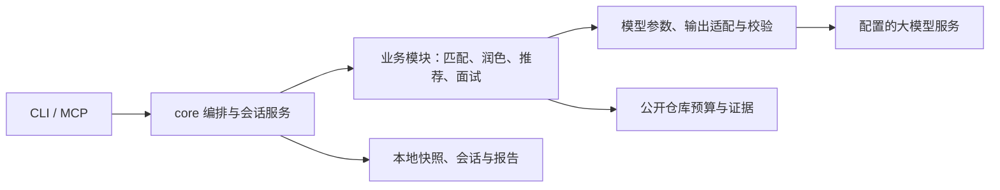

# 完整升级目录与阅读指南

更新：2026-10-26。M01～M09 已实现，当前 **157 项离线测试通过**。M09 为可选自适应试验，默认保持 fixed；M10～M12 尚未实施。真实模型的质量和延迟收益需另行实测。

## 1. 建议阅读顺序

| 你想了解什么 | 从这里阅读 |
| --- | --- |
| 先用几分钟理解整体变化 | 本文第 2、3 节 |
| 直接使用新功能 | 本文第 4 节、[项目使用说明](../README.md) |
| 为什么这样升级、哪些建议没有采纳 | [最终开发路线](FINAL-ROADMAP.md) |
| 第一阶段改了哪些基础问题 | [M01～M05 开发记录](BATCH-1-IMPLEMENTATION.md) |
| 缓存、降级、重启恢复如何工作 | [M06～M07 开发记录](BATCH-2-IMPLEMENTATION.md) |
| 结构化输出和自适应如何落地 | [M08～M09 开发记录](BATCH-3-IMPLEMENTATION.md) |
| 配置不同模型的结构化能力 | [M08 配置与限制](M08-STRUCTURED-OUTPUT.md) |
| 试用、比较和评审自适应面试 | [M09 试验方法](M09-EVALUATION.md) |
| 找实现、测试、提交和后续方向 | 本文第 5～7 节 |

[初版分析](README.md)和[审核意见](Adverse.md)保留讨论历史；当前范围和进度以本文、最终路线及开发记录为准。

## 2. 这轮升级解决了什么

原设计已能完成求职流程，但部分固定提示词和调用链丢失了岗位信息，修改定位不够可靠，模型参数兼容与会话状态也限制了可用能力。

前三阶段依次做了三件事：

1. **把正确材料交给模型。** JD、必要的完整业务经历和事实边界贯穿；不因缺信息就补造身份、职责或指标，改写落在可校验的位置。
2. **让模型依赖可靠工具。** 外部推荐有预算、缓存和来源；面试能保存、恢复和幂等重试，失败不会偷偷推进状态。
3. **在受控范围内扩大决策权。** 配置实际支持的输出格式；面试允许模型根据回答选择澄清、追问或换阶段，同时保留预算、覆盖和用户退出权。

固定 prompt 并非都应删除。事实边界、用户目标、输出契约和安全退出仍需明确；不必要的领域预设、硬套经历和机械追问才是本轮重点清理的限制。

## 3. M01～M12 功能总表

| 编号 | 状态 | 你能感受到的变化 | 详细说明 |
| --- | --- | --- | --- |
| M01 事实与领域 | 已实现 | 风格不再决定技术栈；未知贡献保持未知，不用假档案掩盖错误 | [第一批](BATCH-1-IMPLEMENTATION.md) |
| M02 信息贯穿 | 已实现 | JD、匹配分析和必要业务经历传递完整；材料超预算会明确提示 | [第一批](BATCH-1-IMPLEMENTATION.md) |
| M03 修改定位 | 已实现 | 在冻结快照中按 ID 校验改写，输出原文/改写差异；存疑项保留原文 | [第一批](BATCH-1-IMPLEMENTATION.md) |
| M04 最小模型兼容 | 已实现 | 显式设置参数能力和输出预算；拒绝、截断、中断有独立状态 | [第一批](BATCH-1-IMPLEMENTATION.md) |
| M05 编排与业务语义 | 已实现 | 跨业务协调放回 core；生成物料只表示准备，不自动当作已投递 | [第一批](BATCH-1-IMPLEMENTATION.md) |
| M06 公开推荐证据 | 已实现 | GitHub 有次数/大小/耗时预算、带日期缓存和降级；缺证据不编文件路径 | [第二批](BATCH-2-IMPLEMENTATION.md) |
| M07 会话恢复 | 已实现 | 回答先保存；可暂停、恢复、重试、查看、删除；并发更新明确拒绝 | [第二批](BATCH-2-IMPLEMENTATION.md) |
| M08 分层输出 | 已实现 | 按能力使用原生 schema、JSON mode 或提示词 JSON，只在明确格式不支持时降级 | [M08](M08-STRUCTURED-OUTPUT.md) |
| M09 受控自适应 | 已实现，可选试验 | 模型决定是否值得追问；程序保留覆盖、预算和退出权，支持成对比较 | [M09](M09-EVALUATION.md) |
| M10 宿主协作 | 规划 | 按真实需要增加少量基础工具，比较宿主推理和项目内推理 | [最终路线](FINAL-ROADMAP.md#8-第四阶段由真实需求触发的扩展) |
| M11 长期练习记忆 | 规划 | 跨次待练习点可追溯、可纠正；材料过长时再建设检索 | [最终路线](FINAL-ROADMAP.md#8-第四阶段由真实需求触发的扩展) |
| M12 产品交互扩展 | 规划 | 本地界面、语音、岗位采集分别验证，不合并成一次大改版 | [最终路线](FINAL-ROADMAP.md#8-第四阶段由真实需求触发的扩展) |

M03 的定位 ID 只在相应快照内有效；M06 的星数和来源日期不是实时保证；M09 的规则与测试也不等于生成质量证明。

## 4. 使用入口与兼容方式

旧的 `tailor`、`resume`、`interview`、`radar`、`tracker`、`mcp` 均保留。新增参数为可选项，MCP 仍为 13 个工具。

### 岗位定制与简历

```powershell
# 示例 JD；实际使用时可替换为完整文本或你的 JD 文件路径
uv run jobhunt tailor "示例岗位要求：React、TypeScript 与可访问性" --no-track

# 只从本地档案排版基础简历
uv run jobhunt resume
```

定制流程返回简历草稿、差异报告和原始快照。应核对事实后使用；存疑的改写不会自动替换原文。`--no-track` 关闭准备记录，默认准备记录为 wishlist，真正提交后再推进 applied。

### 面试：流程与模式是两个选择

| 选择 | 含义 |
| --- | --- |
| `--flow fixed` | 默认的固定阶段流式问答，保持原体验 |
| `--flow adaptive` | 单次动作决策，完整校验和保存后显示正文 |
| `--mode simulation` | 默认模拟模式，保持考官视角 |
| `--mode practice` | 训练模式，允许提示和重新作答 |

```powershell
uv run jobhunt interview --flow adaptive --mode practice --company 示例企业 --target-role 前端开发
uv run jobhunt interview --resume-session <session_id>

uv run jobhunt interview-sessions list
uv run jobhunt interview-sessions show <session_id>
uv run jobhunt interview-sessions compare <fixed_id> --with-session <adaptive_id>
uv run jobhunt interview-sessions delete <session_id>
```

`/next` 跳过、`/pause` 暂停、`/retry` 重试、`/finish` 交卷。恢复沿用原事实、岗位、流程和预算，不靠修改当前主档案改变旧会话。删除会话会级联删除请求记录，单独导出的 Markdown 报告需另行删除。

自适应预算默认是 16 轮、1800 秒有效时长、连续追问最多 2 次、每轮 1 次 HTTP 请求、问答总计 32 次请求和单轮生成 30 秒。参数及公平比较方法见 [M09 说明](M09-EVALUATION.md)。复盘单独计费/计请求，不在实时问答预算内。

### 模型配置与离线范围

配置入口见 [settings 示例](../config/settings.example.yaml)。新增能力采用兼容默认；真实配置由使用者自行设置。不要只凭模型名称判断采样、token 参数或严格 schema 能力。

生成定制内容、面试或复盘会调用配置的模型。GitHub `offline: true` 或 `--no-github` 只关闭 GitHub，不能使整个模型流程离线。会话查看、删除和对比是本地操作。

## 5. 实现分布



| 位置 | 负责内容 |
| --- | --- |
| [core/state.py](../core/state.py) | 配置、岗位、候选人、修改提案、会话与决策的数据契约 |
| [core/context.py](../core/context.py) | 业务字段白名单和输入材料 |
| [core/resume_edits.py](../core/resume_edits.py)、[workflow.py](../core/workflow.py) | 快照修改、差异与定制编排 |
| [core/radar_workflow.py](../core/radar_workflow.py) | 跨业务雷达协调 |
| [core/interview_service.py](../core/interview_service.py) | CLI / MCP 共用的恢复、幂等、预算和比较 |
| [skills/mock_interviewer](../skills/mock_interviewer/README.md) | 面试 prompt、固定状态机、自适应决策、存储和复盘 |
| [tools/llm_client.py](../tools/llm_client.py)、[llm_formats.py](../tools/llm_formats.py) | 技术协议、输出格式、有限重试及能力缓存 |
| [tools/github_client.py](../tools/github_client.py) | 公开资料读取、预算和缓存 |
| [main.py](../main.py)、[run_interview.py](../run_interview.py)、[MCP 说明](../adapters/README.md) | 终端和 MCP 入口 |
| [仓库面试 Skill](../.agents/skills/jobhunt-mock-interview/SKILL.md) | 宿主调用方式和同步的参数说明 |

业务模块之间不互相 import。协调通过 core 和数据契约完成；MCP 可达路径保持 stdout 只用于 JSON-RPC。

私有产物继续位于 Git 忽略的 `storage/`：会话库 `interviews.db`、投递库 `tracker.db`、公开资料缓存 `github_cache.db`、能力缓存 `llm_capabilities.db` 及简历/报告。会话数据库 v2 仅向合规的 v1 结构增加指标列，旧事实与历史不重写。

## 6. 测试与提交索引

统一回归：`uv run --no-sync pytest -q`，当前 157 项通过。全部使用合成材料、临时存储和模拟服务，不代表已完成真实端点的生成质量评审。

| 想核对的边界 | 测试 |
| --- | --- |
| 定向改写、重复原文、过期快照 | [test_resume_tailoring.py](../tests/test_resume_tailoring.py) |
| 参数、拒绝、截断、格式适配与预算 | [test_llm_client.py](../tests/test_llm_client.py) |
| 公开缓存、限流、证据与降级 | [test_github_recommendations.py](../tests/test_github_recommendations.py) |
| 不同岗位与事实边界 | [test_interview_context.py](../tests/test_interview_context.py) |
| 重启、并发、取消、幂等与报告 | [test_interview_persistence.py](../tests/test_interview_persistence.py) |
| 真实终端循环与 MCP 子进程重启 | [test_interview_entrypoints.py](../tests/test_interview_entrypoints.py) |
| 自适应决策、预算、指标、迁移和原子展示 | [test_adaptive_interview.py](../tests/test_adaptive_interview.py) |
| 原有入口、业务隔离与协议 | [CLI/雷达](../tests/test_radar_and_cli.py)、[MCP 协议](../tests/test_mcp_protocol.py)、[MCP 工具](../tests/test_mcp_tools.py) |

| 批次 | 主要提交 |
| --- | --- |
| 第一批 M01～M05 | `9513eab`、`7b977ce`、`5180d96`、`b69cc9b`、`183b109`；记录与约定 `72c9006` |
| 第二批 M06～M07 | `e5aacbd`、`f761231` |
| 第三批 M08～M09 | `3ab540d`、`4949b4a` |

各批记录中的 71、113、157 是相应阶段的历史测试总数，不是互相独立的质量分数。

## 7. 接下来应做什么

优先按 [M09 评审表](M09-EVALUATION.md#最小人工评审表)做少量真实模型成对验证，记录实际版本、参数、延迟、费用、失败率和人工理由。满足事前约定标准后，再决定是否调整默认流程。

M10 宿主协作、M11 长期记忆、M12 界面/语音/采集按实际使用痛点分别推进。当前没有把未来规划包装成已交付功能，也没有把关键词检查或合成耗时当作质量提升的证据。
